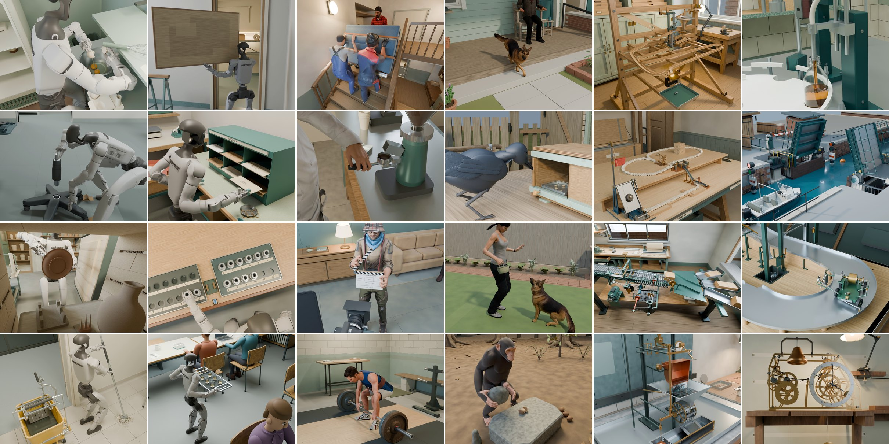

# DyCraft: An Agentic System for Long-Horizon 4D Scene Generation

[Jeff Tan](https://jefftan969.github.io/)\*, [Hang Dai](https://daihangpku.github.io/)\*, [Zeqian Long](https://zeqian-long.github.io/)\*, [Yanzhe Lyu](https://yanzhelyu.github.io/), [R. Kenny Jones](https://rkjones4.github.io/), [Shangzhe Wu](https://www.elliottwu.com/), [Chen Geng](https://chen-geng.com/)†, [Jiajun Wu](https://jiajunwu.com/)†

[Project page](https://dy-craft.github.io) | [arXiv](https://arxiv.org/abs/2610.40754) | [Data](https://huggingface.co/datasets/jefftan969/dycraft-films)

[](https://dy-craft.github.io)

DyCraft is an agentic system for creating minute-long 3D animations in Blender from text prompts.
Designed on top of native coding agent harnesses (Codex or Claude Code), DyCraft provides a workflow and set of tools for long-horizon animation, including planning, prompt
rewriting, 3D coding, animation storyboarding, motion authoring, physical verification, and review.

## Overview

DyCraft includes four agent types, selected with `--layer`:

| Layer | What the agent does | Output |
|---|---|---|
| `animation` | Plans, storyboards, animates, and renders a complete sequence in Blender | A `.blend` and a rendered film |
| `scene` | Builds a scene and its objects in CAD | The scene's layout and the objects' meshes |
| `object` | Builds one articulated object in `build123d` CAD | The object's parts, joints, and meshes |
| `plain` | Responds to a one-off text prompt | Text |

The full text-to-film pipeline is the `animation` layer. It builds on the other agent types, which are also useful on their own.

## Installation

`python -m dycraft.install check` reports what is installed, what is missing, and the command that fixes each item.
Run it after each step, and again whenever something fails. See the [install guide](docs/install.md) for more details.

### Requirements

- Linux (x86_64).
- `bubblewrap` and `socat` for the agents' sandboxes, and `ffmpeg` for the films, from the system or, without root,
  from `python -m dycraft.install tools`. On Ubuntu 24.04, `bwrap` also needs an AppArmor profile that grants it user
  namespaces, which takes root to add.
- [uv](https://docs.astral.sh/uv/) or [conda](https://docs.conda.io/) for the Python environments.
- [Claude Code](https://code.claude.com/docs/en/setup) or [Codex](https://learn.chatgpt.com/docs/codex/cli), installed
  and logged in (`claude auth login` or `codex login`).
- No GPU is needed: Blender renders on the CPU when there is none.

### Install

Create the environment with uv:

```bash
curl -LsSf https://astral.sh/uv/install.sh | sh
git clone https://github.com/jefftan969/dycraft.git && cd dycraft
uv venv --python 3.13 .venv && source .venv/bin/activate
uv pip install -e .
```

Or with conda:

```bash
git clone https://github.com/jefftan969/dycraft.git && cd dycraft
conda env create -f environment-main.yml -n dycraft && conda activate dycraft
pip install -e .
```

Then:

```bash
python -m dycraft.install check      # lists what is missing, and the command that fixes it
python -m dycraft.install tools      # the system tools the check reports missing, without root
python -m dycraft.install cad        # sets up CAD (build123d) in this environment
python -m dycraft.install blender    # Blender 4.5 for the animation agent (about 380 MB)
python -m dycraft.install library    # the people, animals and robots that briefs cast
python -m dycraft.install check
```

### Optional

| Part | Install | Without it |
|---|---|---|
| Inverse kinematics (cuRobo; needs an NVIDIA GPU) | `python -m dycraft.install ik` | The agent solves reaches and footsteps itself |
| Motion capture: CMU (people); `--dog` adds MANN (dogs, CC BY-NC 4.0) | `python -m dycraft.install mocap` | The agent authors all motion itself |
| The viewer's frontend (Node.js 20.19 or later) | [Interactive Viewer](#interactive-viewer) | Runs work the same |

## Getting Started

See the [usage guide](docs/usage.md) for more details on every agent type, option, and the asset library.

### Make a Film

```bash
python -m dycraft.cli --backend codex --layer animation \
    --prompt "A red ball rolls across a table and falls off the edge."
```

The most common options:

| Option | Description |
|---|---|
| `--model` | The model, for example `gpt-6-astra` or `claude-opus-5-5` (default: the CLI's own default) |
| `--reasoning-effort` | `low`, `medium`, `high`, or `xhigh` (default `xhigh`; Claude Code also accepts `max`) |
| `--max-hours` | The time budget in hours (default 12; 0 for none) |
| `--runs-dir`, `--run-id` | Location of the run directory, and name of the run |

`python -m dycraft.cli --help` lists every option. For example, with an 8-hour budget:

```bash
python -m dycraft.cli --backend codex --model gpt-6-astra --reasoning-effort xhigh --max-hours 8 \
    --layer animation --prompt brief.md
```

Use `--backend claude` to run Claude instead. `--prompt` takes either the animation prompt or the path to a file. A
text file is read as the prompt, and any other file, such as a PDF or an image, is given to the agent to open. The launcher will print the run directory, `runs/<run_id>/`. When the run finishes, the film is
`film.mp4` in that directory and the Blender file is `animation.blend`, beside a `README.md` that says how the run went
and what to do next. The agent's own files are in `src/`.

This example usually takes one to two hours, even on a machine without a GPU. A brief with a character or a robot takes
considerably longer, for example one with the Unitree G1 from the [asset library](docs/usage.md#asset-library):

```bash
python -m dycraft.cli --backend codex --layer animation \
    --prompt "A humanoid robot lying on the floor gets up and stands."
```

With GPT-6-Astra in Codex, the paper's films took a median of 11 hours of agent time per minute of film, or 15 counting the helper agents. Runs stop after 12 hours by default, you can set the time limit with `--max-hours H` (0 for none). Giving long animation prompts that are impossible to complete within the time limit is a common failure mode of our system: we encourage starting with simple prompts first and gradually scaling up. We provide the 24 benchmark prompts from the paper in [agent/prompts/animation_24_briefs.md](agent/prompts/animation_24_briefs.md). See the [benchmark guide](docs/benchmark.md) for running the benchmark and for the paper's films.

### Resume a Run

If a run stops before it finishes, for example at a usage limit or after a crash, continue it in the same run
directory:

```bash
python -m dycraft.cli --resume runs/<run_id>
python -m dycraft.cli --resume runs/<run_id> --prompt "keep the camera on the ball as it falls"
```

The agent continues its Claude Code or Codex session with the same settings. With `--prompt`, your message is given to
the agent when it resumes. A resumed run gets what is left of its time limit, counting only the time the agent was
running. `--max-hours H` gives it H more hours, and a run that used its whole limit needs `--max-hours` to continue.
On a run that already delivered its film, `--resume` with `--prompt` revises it, and the earlier version is kept in
`src/prior_deliveries/`.

### Export to GLB

```bash
python -m dycraft.export glb runs/<run_id>
```

This writes `animation.glb` in the run directory for a film, or `scene.glb` or `object.glb`. A film keeps its motion
and its cameras. Objects and scenes are exported at rest. Lights are not exported. The command also takes any `.blend`,
or one of the [paper's films](#benchmark-and-the-papers-films) after download, such as
`films/B11_film_crew_sets_dolly_shot`. It needs only the Blender install.

Procedural materials become one flat color each, and the command lists the objects that have them. `--bake-materials`
bakes them into textures with Cycles instead. Use a GPU for a film. A short film exports in under a minute. The
heaviest of the paper's films takes 7 to 14 minutes and 14 GB of memory on a 16-core CPU, or 16 minutes and 9 GB with
`--jobs 1`. See the [usage guide](docs/usage.md#exporting-to-glb) for more details.

### Scenes and Objects

```bash
python -m dycraft.cli --backend codex --layer scene \
    --prompt "a small reading nook: an armchair, a side table with a stack of books, a floor lamp"
python -m dycraft.cli --backend codex --layer object \
    --prompt "a desk lamp with a weighted base, a two-link arm and a tilting shade"
```

DyCraft's object and scene agents can also be called independently. With GPT-6-Astra, an object takes minutes to an hour. Each run directory holds the result as `object.urdf` or `scene.urdf`, with the meshes in `meshes/`, the final renders in
`views/`, and a `README.md`. The agent's own files are in `src/`, as for a film.

### Use Your Own Assets

```bash
python -m dycraft.cli --backend codex --layer animation \
    --preload-asset robot=path/to/bundle --prompt brief.md      # the agent loads it with load_asset("robot")
```

`--preload-asset NAME=PATH` gives a scene or animation agent a model to place. `PATH` can be a finished object or scene
run, such as `runs/<run_id>`, or a bundle from one of these importers, for URDF robots and for rigged characters in
glTF/GLB, FBX, or `.blend`:

```bash
python -m dycraft.agent.assets.import_urdf --urdf path/to/robot.urdf --out assets/imported/my_robot --name my_robot
python -m dycraft.agent.assets.import_gltf --in character.glb --out assets/imported/my_character
```

A bundle under `assets/imported/` joins the asset library once you rebuild its index with
`python -m dycraft.agent.assets.asset_library`. See the [usage guide](docs/usage.md#importing-your-own) for more details.

## Interactive Viewer

We provide an interactive viewer for inspecting finished runs and agent trajectories.

To build it, use Node.js 20.19 or later and npm:

```bash
npm --prefix viewer/web ci
npm --prefix viewer/web run build
```

Then start it from the DyCraft environment:

```bash
python -m dycraft.viewer                                   # http://127.0.0.1:8770
python -m dycraft.viewer --runs-dir /other/runs --port 9000
```

By default it reads the runs directory the launcher uses. To open it from another machine, forward the port with
`ssh -L 8770:127.0.0.1:8770 <host>`. Build it before a regular `pip install .`, so the package includes it.

| Control | Action |
|---|---|
| Drag | Orbit |
| Right-drag, or `Ctrl`/`⌘`-drag on a trackpad | Pan |
| Scroll | Zoom |
| `W` `A` `S` `D`, or the arrow keys | Fly forward, left, back, and right |
| `E` or `Space` | Fly up |
| `Q` or `Shift` | Fly down |

The keys work while the pointer is over the 3D view, or after you click it. Flying speed scales with the distance to
what you are looking at, so the same keys move through a cabinet or across a large room.

## Running Claude Code and Codex

DyCraft automatically starts Claude Code or Codex using your existing login. Each run gets its own directory under `runs/`, and the
agent works in its `src/` folder. It calls DyCraft's tools from its shell and can start helper agents for parts of the
task.

DyCraft runs the agents unattended, with these settings:

| Setting | Claude Code | Codex |
|---|---|---|
| Approvals | `--permission-mode dontAsk` | `--ask-for-approval never` |
| Sandbox | Required, with no way to run a command outside it | `--sandbox workspace-write`, tested before each launch |
| File writes | The run's `src/` only | The run's `src/` and temporary directories |
| Network from the agent's shell | `localhost` only | Allowed |
| Your own configuration | Hooks off; no MCP servers (`--strict-mcp-config`) | `~/.codex/config.toml` applies; the run's `src/` is marked `untrusted` there during the run |
| Time limit | 12 hours (`--max-hours`) | 12 hours (`--max-hours`) |

The run does not start if the sandbox cannot start. See the [architecture guide](docs/architecture.md#sandbox-settings)
for more details, and the [install guide](docs/install.md#sandbox-fails-to-start) for fixes. Where the sandbox cannot be
fixed, `--allow-unsandboxed` runs the agent without it, so its commands can read and write anywhere you can.

The agent sees your shell's environment. If `ANTHROPIC_API_KEY` or `OPENAI_API_KEY` is set there, the CLI may bill that
key instead of your subscription, and the agent can read it.

## Benchmark and the Paper's Films

The paper compares DyCraft with a bare coding agent that has Blender but no DyCraft tools. These commands run both variants on
the short versions of the paper's 24 briefs, score every film, and write a report with each brief's films side by
side:

```bash
python -m dycraft.benchmark.run    --briefs short --agent codex --out runs/bench_short   # DyCraft
python -m dycraft.benchmark.bare   --briefs short --agent codex --out runs/bench_short   # the bare agent
python -m dycraft.benchmark.score  runs/bench_short
python -m dycraft.benchmark.report runs/bench_short
```

The 24 films DyCraft made for the paper, with their Blender projects, plans, and briefs, are in the
[dycraft-films dataset](https://huggingface.co/datasets/jefftan969/dycraft-films). To download them and play one in
the viewer:

```bash
python -m dycraft.install films                    # all 24 films, 13.6 GB; --brief B05,B13 for some
python -m dycraft.viewer --runs-dir films
```

The first time you open a film, the viewer takes a moment to prepare it, about a minute for the larger films. Later
openings are immediate. See the [benchmark guide](docs/benchmark.md) for more details.

## Documentation

- [Install guide](docs/install.md): per-component installation, checking the setup, and fixing install problems
- [Usage guide](docs/usage.md): agent types, options, models and accounts, and external character and robot assets that agents can use
- [Benchmark guide](docs/benchmark.md): the paper's animation briefs, bare agent comparisons, scoring, and films
- [Architecture](docs/architecture.md): the code behind each part of the paper's method (prompt rewriting, planning, CAD scene construction, storyboarding, motion authoring, verifiers, and review), sandbox settings, and running the unit tests

## Repository Layout

See the [architecture guide](docs/architecture.md) for more details.

- `agent/`: agent sessions, the DyCraft harness server, and system prompts for agent types
- `cli/`: CLI launcher and the Claude Code and Codex backends
- `sdk/`: CAD library that agents use to build objects and scenes
- `verify/`: verifier checks for objects, scenes, and animations
- `render/`: tools for rendering the films
- `animation/`: the animation agent, its Blender worker, inverse kinematics, and motion capture
- `viewer/`: interactive viewer
- `export/`: GLB export of runs and films
- `benchmark/`: bare agent comparisons, benchmark runner, and scorer
- `catalogs/`: metadata for the asset library
- `.claude/skills/`, `.agents/skills/`: skills for Claude Code and Codex
- `docs/`: documentation
- `tests/`: unit tests
- `install.py`, `environment_test.py`: installation helper and setup check

## Citation

```bibtex
@article{tan2026dycraft,
  title   = {DyCraft: An Agentic System for Long-Horizon 4D Scene Generation},
  author  = {Tan, Jeff and Dai, Hang and Long, Zeqian and Lyu, Yanzhe and Jones, R. Kenny and Wu, Shangzhe and Geng, Chen and Wu, Jiajun},
  journal = {arXiv preprint arXiv:2610.40754},
  year    = {2026}
}
```

## License and Acknowledgements

DyCraft is released under the [Apache License 2.0](LICENSE). The run viewer's frontend is adapted from
[Articraft](https://github.com/mattzh72/articraft), under the same license. The cuRobo documentation
is mirrored for offline use. [NOTICE](NOTICE) lists the third-party attributions, including asset
credits.
